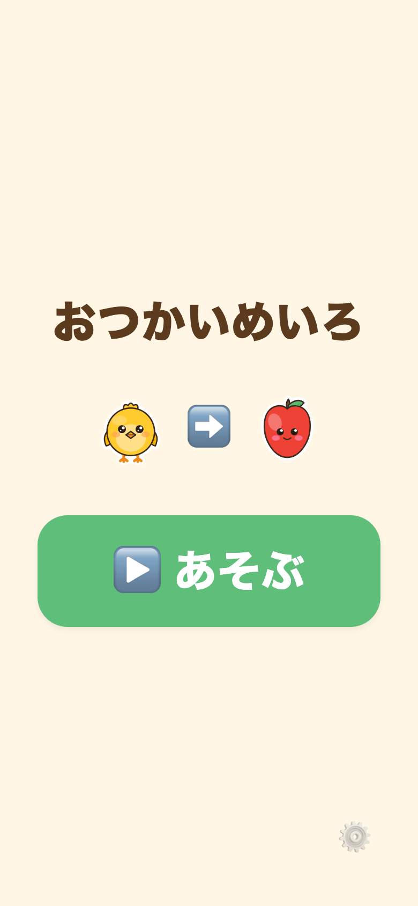

# おつかいめいろ

4歳の姪っ子のための知育アプリ。マス目の上でアバターを動かしてゴール（りんご・おうち）まで届ける、超やさしいプログラミング体験。プログラミング的思考（順序立て・試行錯誤）の下地を遊びとして届けることを狙う。絵本「ルビィのぼうけん」の延長、小学校プログラミング教育（2020年度〜必修）への接続を意識。



## 公開URL

**▶ https://kerokero-1245.github.io/otsukai-meiro/**

ブラウザで開いてそのまま遊べる。スマホなら「ホーム画面に追加」で全画面起動。
`main` に push すると GitHub Actions（[.github/workflows/deploy.yml](.github/workflows/deploy.yml)）が Web を書き出して自動デプロイする。

整形の検査（Prettier）・静的解析（ESLint）・型チェック・テストが通り、Web の書き出しができたときだけ公開し、PR でも同じ検査を回す。

- 企画（厳選5案の比較）: [docs/IDEAS.md](docs/IDEAS.md)
- 設計（画面・データモデル・ロードマップ）: [docs/DESIGN.md](docs/DESIGN.md)
- 作り方の規則と、この repo で違うこと: [docs/DESIGN.md](docs/DESIGN.md#この-repo-での適用)

## 状態

**フェーズ1（タップで即1マス動く）＋フェーズ2（パーソナライズ）＋フェーズ4（②ならべてゴー）実装済み・Webファースト。** タイトル → レベルえらび → プレイ → 祝福（ついたね!）まで遊べる。むずかしさカード5枚から迷路を毎回ランダム生成。おとなモード（⚙️3秒長押し）で **ゴールを実在の写真に**、**クリアの声をおじの録音に**できる（完全端末内・外部送信ゼロ → [パーソナライズ](#パーソナライズこの子だけの世界地図)）。①に慣れたら **[やじるしモード](#やじるしモードならべてゴー)**（矢印を並べて「ゴー!」）へ切り替えられる。

配布は **Webファースト**: Expo の web ビルドを URL で配布し、ブラウザで開いて「ホーム画面に追加」すれば全画面で遊べる。ネイティブアプリ（App Store 等）は同じコードから後日。詳細は DESIGN.md §0。

## 前提・方針

- 対象: 4歳（未就学・ひらがなは読み始め）。スマホ操作経験あり
- 既存キャラIP（アンパンマン等）は使わない — 姪っ子本人が主役になる設計
- 受け身の視聴ではなく「自分で操作して考える・作る」遊び
- 作り手（おじ/おば）は遠方在住 — 離れていても関われる要素を重視
- MVPはコア機能1つに絞る。まず姪っ子1人が喜べばOK、ストア公開は二の次
- 完全オフライン: バックエンド・アカウント・通信なし。データは端末内のみ
- 技術: Expo SDK 57 (React Native + TypeScript)、Node 24.21.0

## 動かし方

前提: **Node の版は `.nvmrc` に従う**（macOS 既定の v16 では Expo が動かない。nvm なら `nvm use`）。

```sh
npm install          # 初回のみ
npm start            # Expo を起動 → ターミナルで w を押すと Web が開く
```

- `w` … ブラウザで開く（Webファースト。まずはこれ）
- `i` / `a` … iOS シミュレータ / Android エミュレータ（任意）
- 実機は Expo Go アプリで QR を読み取り（任意）

ショートカット: `npm run web`（`w` を押さず直接 Web 起動）。型の確認は `npm run typecheck`（`tsc --noEmit`）。

テスト: `npm test`（Node 組み込みの `node --test`。新しい依存なし）。迷路の生成・移動・⭐の保存など、画面に依らないロジックと保存の規則を確かめる。

### Web ビルド（配布用の静的サイト書き出し）

```sh
npx expo export --platform web      # dist/ に静的ファイルを書き出す（ルート配信用）
```

`dist/` を GitHub Pages 等に載せ、URL を配布 → ブラウザで開き「ホーム画面に追加」で全画面起動（DESIGN §0）。

GitHub Pages はサブパス（`/otsukai-meiro/`）配信のため、CI では `EXPO_BASE_URL=/otsukai-meiro` を渡して書き出す。この環境変数を [app.config.js](app.config.js) が `experiments.baseUrl` に反映し、**ビルド時のみ**アセットのベースパスを付ける（ローカルの `npm start` には影響しない）。手元でサブパス配信を再現するなら:

```sh
EXPO_BASE_URL=/otsukai-meiro npx expo export --platform web
```

公開 HTML の型は [public/index.html](public/index.html)（`lang="ja"`・説明文・OGP・manifest へのリンク・読み込み中の背景色）。`public/` のほかのファイル（`manifest.webmanifest`・`icon-192.png`・`icon-512.png`・`apple-touch-icon.png`・OGP 画像 `og.png`）は書き出しにそのままコピーされる。アイコン類（`public/` と `assets/` の PNG）は、街の こうえん と同じ自作 SVG（piyo-assets の `ki.svg`。`assets/piyo/ki.svg` と同一）から作った。

### 遊び方

タイトルの「あそぶ」→ カードで**むずかしさ**を選ぶ → その難易度の迷路が**その場でランダム生成**される → ◀▲▼▶ をタップしてアバターを1マスずつ動かし、ゴール（りんご・おうち等、毎回ランダム）へ。壁や障害物の向きを押すとキャラが首をかしげるだけ（罰・ゲームオーバー無し）。ゴールで「ついたね!」の祝福。「もういちど」で同じ難易度の**新しい迷路**に挑戦（さんすうドリルのように何度でも）。
※ タイトル右下の歯車を **3秒長押し** すると、おとなモード（写真・こえ・**あそびかた**・⭐リセット・BGM）に入る。
※ 横向きのスマホ（844x390・568x320 など）では、めいろ画面が左に「🏠・ゴール案内・めいろ盤」、右に ◀▲▼▶ の左右の並びになる（② の命令の列は ◀▲▼▶ の上）。
※ タイトル左上の「まちへ もどる」で ぴよぴよランド（同じオリジンの `/`）へ戻る（Web のみ。レベルえらび・プレイ・祝福・がんばりカード・おとなモードには置かない）。

**⭐**: クリアしたレベルのカードに⭐が付く（`meiro.stars`）。それとは別に、クリアのたびに累計 `meiro.totalStars` が1つ増え（再クリアも +1）、街（ぴよぴよランド）がこれを燃料として読む。おとなモードの「⭐をリセット」はカードの⭐と「ぜんぶ できたね!」の印だけを消す。**街へ渡す累計 `meiro.totalStars` は減らさない。**

**② ならべてゴー（やじるしモード）** … おとなモードの「あそびかた」を ② にすると、矢印を押しても
その場では動かず**画面上部の「命令の列」に積まれ**、十字のまんなかの「**ゴー!**」で先頭から1マスずつ実行する
（けいかく→じっこう→かんさつ→しゅうせい）。→ [やじるしモード](#やじるしモードならべてゴー)

## 画面・ファイル構成

```
App.tsx                     文字ヘッダ無しの最小ステートルーター（title→select→play→ganbari／otona）
src/
  theme.ts                  配色・フォント・余白の基準値（4歳向け）
  layout.ts                 枠の余白・最大幅と、背の低い横向き（スマホの横持ち）の判定
  types.ts                  Template / Level / Coord / Direction / Route など（DESIGN §7 準拠）
  settings.ts               あそびかた（meiro.mode: 'tap' | 'queue'。既定 'tap'）の読み書き
  a11y.ts                   useReducedMotion()（prefers-reduced-motion。②の演出だけ控える）
  data/templates.json       むずかしさテンプレート定義（5個。カード＝難易度の型）
  data/templates.ts         テンプレート読み込み・次テンプレート取得
  game/maze.ts              move / canMove / isGoal など盤面の純粋関数
  game/generate.ts          テンプレートから迷路をランダム生成（BFS検証つき・詰み無し保証）
  audio/sounds.ts           効果音（web は Web Audio で合成、native は無音スタブ）
  audio/voice.ts            よみあげの入口（4段構え ⓪おじの声→①同梱クリップ→②speechSynthesis→③無音）＋声中のBGMダッキング
  audio/clips.ts            tier0/1: クリップ・録音の再生（HTMLAudioElement / native 無音）
  audio/voiceClips.ts       tier1: 同梱クリップ登録表（VOICEVOX ずんだもん 3個）
  audio/speech.ts           tier2: 端末の音声合成（Web Speech API / native 無音）
  audio/bgm.ts              BGM 配線の入口（曲=meiro / トグル meiro.bgm / ダッキング / ctx共有）。エンジンと曲のデータは src/ に置かず、共有パッケージ piyo-assets（`@kerokero-1245/piyo-assets/bgm/engine`）から読む
  personal/                 パーソナライズ（ゴール写真・おじの声。web のみ・完全端末内）
    idb.ts                  IndexedDB 最小ラッパ（DB名 meiro-personal。例外を投げない）
    image.ts                canvas で長辺512px・JPEG0.8 に縮小（EXIF向き対応）
    filePicker.ts           隠し <input type=file> を1つ置いて click する
    recorder.ts             getUserMedia + MediaRecorder（mime判定・自動停止・マイク解放）
    store.ts                在庫（メモリ）＋追加/削除＋購読。pickGoalPhotoUrl() を公開
  components/
    MazeGrid.tsx            盤面（タイル・障害物・ゴール・アバター）
    DirPad.tsx              ◀▲▼▶ の巨大方向パッド（②は十字のまんなかに「ゴー!」）
    CommandQueue.tsx        ②の「命令の列」（積んだ矢印・空きマス・実行中の光り・⌫）
    GoButton.tsx            ②の「ゴー!」（緑のまる。矢印が0本ならうすく押せない）
    Avatar.tsx              アバター（丸いバッジにシールポップのぴよ）
    ClearOverlay.tsx        ゴール祝福オーバーレイ（写真ならズーム表示）
    ConfirmBox.tsx          おとなモードの確認ボックス（問い ＋ けす ＋ やめる。写真・録音・⭐の削除の前に 1 枚はさむ）
    GoalArt.tsx             ゴールの見た目（写真 or シールポップSVG or 絵文字）
    PiyoArt.tsx             絵文字グリフ → シールポップSVG の差し替え
  screens/
    TitleScreen.tsx         タイトル（あそぶ / まちへ もどる / 親ゲート）
    LevelSelectScreen.tsx   レベルえらび（横スクロール）
    PlayScreen.tsx          プレイ本体（①タップモード ／ ②ならべてゴー）
    GanbariScreen.tsx       ぜんぶ できたね! がんばりカード
    OtonaScreen.tsx         おとなモード（しゃしん / こえ / あそびかた / ⭐リセット / BGM トグル）
public/                     Web 書き出しの HTML の型・manifest・アイコン・OGP 画像
```

大ボタン（small / big / huge）・紙吹雪・「まちへ もどる」（街へのリンク）・おとなモードの長押しは src/ に置かず、共有パッケージ piyo-assets の `@kerokero-1245/piyo-assets/ui` から読む（見た目の値は App.tsx の `PiyoUiProvider` で `src/theme.ts` から渡す）。

## やじるしモード（ならべてゴー）

DESIGN §3 の「②ならべてゴー」。**けいかく → じっこう → かんさつ → しゅうせい** のループを4歳が
指1本で回せる形にしたもの。設計の詳細は [DESIGN.md §16](docs/DESIGN.md)。

- **既定は① のまま。** おとなモードの「あそびかた」を ② にするまで、こども側は完全にこれまでどおり
  （保存キー `meiro.mode`・端末内のみ・いつでも①に戻せる）。
- **矢印を押す = 命令の列に積む**（その場では動かない）。上限まで積んだら**静かに受け付けない**
  （空きマスが無いことで「いっぱい」が見える）。取り消しは **⌫（さいごを1つ消す）** だけ。
- **「ゴー!」は十字のまんなか**（Bee-Bot / Cubetto 流）。1歩ずつ実行し、いま動いている命令が緑に光る。
- **動けない歩でも実行は止めない** — 首をかしげて次の命令へ進む（＝言われたとおりに動くのを観察する）。
- **届かなくても失敗ではない** … 首をかしげて**スタートへ ぴょんと戻り**、列が空になって組み直せる。
  タイマー・ライフ・減点は無く、⭐も減らない。途中でゴールに着いたら残りの命令は捨てて即クリア。
- **上限は迷路ごとに可変**（実際の最短手数＋4本、最低6本）。4×4は最短10手の迷路が起こりうるため、
  固定10本では余白がゼロになる迷路が出る（実際に出るのは 6〜14本）。
- **命令の列が増えても、こどもが触るものは小さくならない** … 帯の高さは上限本数によらず 64px 固定で、
  方向ボタン・ゴー! は①とまったく同じ一辺、⌫ は 64×64。縦が足りないときに削るのは
  「盤面のマス」と「帯のマスの見た目」の順（→ [DESIGN §16.2](docs/DESIGN.md)）。
- レベルえらび・迷路生成・移動判定・⭐・クリア演出は**①と完全に共通**。②が足すのは UI だけ。
- **新規 npm 依存ゼロ**、新しい音声クリップもゼロ（既存の合成SEの再利用）。
  `prefers-reduced-motion` のときは首かしげの回転と ぴょんの弧を控える（1歩ずつ進むことは残す）。

## パーソナライズ（この子だけの世界地図）

このアプリの差別化の核。おとなモード（⚙️3秒長押しの奥）で、**ゴールを実在の写真**（おばあちゃんの家・公園）に、
**クリアの声をおじの録音**にできる。設計の詳細は [DESIGN.md §15](docs/DESIGN.md)。

- **ゴールの しゃしん** … 最大6枚。保存前に **長辺512px・JPEG0.8** に縮小して **IndexedDB**（DB名 `meiro-personal`）へ。
  写真があると、そのプレイのゴールが **2/3 の確率で写真**になる（残りは従来どおり12種のシールポップ絵）。
  マスの上では白フチ角丸のシール風、クリア演出では白い台紙で大きくズーム。
- **こえ** … 「ついたね!」「ぜんぶ できたね!」の2スロットを `MediaRecorder` で録音（最長6秒）。録音があると
  ずんだもんクリップの**代わりに**鳴る（BGM ダッキングも同じ経路を通る）。ためしぎき・とりなおし・削除つき。
- **プライバシー** … 写真も録音も**この端末の中だけ**。通信・アカウント・クラウドはゼロ。1枚ずつ／ぜんぶ／録音とも
  いつでも消せる。破壊的操作には確認を1枚はさむ。
- **壊れないこと** … IndexedDB が使えない環境（プライベートブラウズ等）ではクラッシュせず、おとなモードの2セクションが
  「つかえません」表示に変わるだけ。こども側は完全に従来どおり（絵文字ゴール・ずんだもん）。写真の読み込み失敗も
  静かに絵へフォールバック。
- **新規 npm 依存ゼロ**（`<input type=file>` / canvas / IndexedDB / getUserMedia / MediaRecorder のブラウザ標準APIのみ）。
  ネイティブでは `Platform` 分岐で「つかえない」を返すスタブ。

## 音声（こえ）

効果音（`audio/sounds.ts` の合成音）とは別レイヤーで、3か所で声を鳴らす。
読み上げは4段構え（`audio/voice.ts`）: **⓪ おじの声（おとなモードの録音）→ ① 同梱クリップ（VOICEVOX ずんだもん）→ ② 端末の音声合成（Web Speech API）→ ③ 無音**。
声はすべてユーザー操作（タップ）起点。効果音と喧嘩しないよう、声は効果音の**あと**に遅らせて鳴らす。

| 場面                           | 声（同梱クリップ）                 | 差し替え                            | 効果音との順序                              |
| ------------------------------ | ---------------------------------- | ----------------------------------- | ------------------------------------------- |
| タイトルをタップ               | 「おつかいめいろ」（`p_title`）    | —                                   | ここで声エンジンをアンロック（warmUpVoice） |
| ゴール到達（ClearOverlay）     | 「ついたね！」（`p_tsuita`）       | おとなモードの録音スロット `tsuita` | 既存 `clear` 効果音の約0.75秒後に発声       |
| 全レベル制覇（がんばりカード） | 「ぜんぶ できたね！」（`p_zenbu`） | おとなモードの録音スロット `zenbu`  | 既存 `fanfare` 効果音の約1秒後に発声        |

壁・障害物にぶつかったときは既存の `blocked` 効果音のまま（**声は出さない**）。

クリップは `assets/voice/` に同梱（`audio/voiceClips.ts` の `CLIP_URLS` で登録）。同梱クリップを持たない環境（native 等）は
② 端末の音声合成へ自動フォールバックし、それも無ければ ③ 無音（絵・文字だけで成立）。生成手順・パラメータ・クレジット
（**VOICEVOX:ずんだもん**）は [`assets/voice/README.md`](assets/voice/README.md) を参照。

## BGM（おんがく）

姉妹アプリ共通のオルゴール風 BGM を配線（`audio/bgm.ts` → 共有パッケージ [piyo-assets](https://github.com/kerokero-1245/piyo-assets) の `bgm/engine`。`package.json` の git 依存で、タグで固定した版を読む）。曲は **meiro**（すこしわくわく・
G メジャーペンタ・84BPM・16小節シームレスループ）。音源ファイルは同梱せず **Web Audio API でその場合成**する
手続き生成ループ（効果音・声と同じく外部送信ゼロ・完全オフライン）。

- **開始**: 最初のユーザー操作（タイトルをタップ／「あそぶ」）で `startMeiroBgm()`。iOS Safari の自動再生制限に合わせ
  必ずタップ起点。以降は画面遷移でも途切れず流し続ける（クリア演出中も継続）。
- **ダッキング**: 声（タイトル・ついたね・ぜんぶ できたね）の再生中だけ BGM を約35%へ沈め、終了で戻す
  （`audio/voice.ts` が `duckForVoice` / `unduckForVoice` を呼ぶ。ended/error/停止/無音のいずれでも確実に復帰）。
- **トグル**: おとなモードに「BGM: ながす／ながさない」（既定 **ON**・`localStorage` キー `meiro.bgm` に `"on"`／`"off"`。
  旧版の値 `"1"`／`"0"` は読んだときに `"on"`／`"off"` に書き直す）。OFF で即停止、
  ON で（ジェスチャ文脈なら）即再開。リロードしても設定は保持。
- **AudioContext 共有**: 効果音（`audio/sounds.ts`）と同じ `AudioContext` を共有（`configureBgm({ getCtx })`）。
- 非対応環境（native・AudioContext 無し）・`localStorage` 例外でも全て無害な no-op（遊びは壊さない）。

**BGM: オリジナル（Web Audio 生成）**。録音物・外部素材は使っていない。
